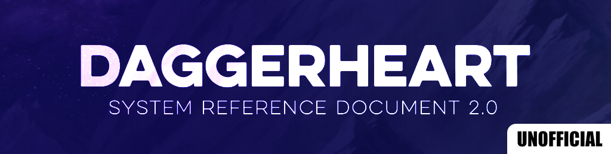

# Daggerheart SRD 2.0 content for Encounter+

The Daggerheart System Reference Document (SRD) 2.0 packaged as an Encounter+ module: adversaries, ancestries, classes, domain cards, equipment, environments and the rules text, ready to use with the Daggerheart game system.

## Repository layout

Each entity lives in its own file, so changes are easy to review. The build combines them into one collection per folder.

| Path | Contents |
| --- | --- |
| `adversaries/`, `ancestries/`, `armor/`, `beastforms/`, `classes/`, `communities/`, `consumables/`, `domain-cards/`, `environments/`, `items/`, `rules/`, `subclasses/`, `tables/`, `transformations/`, `weapons/` | One JSON file per entity |
| `pages/` | Rules pages as Markdown with a YAML front matter header |
| `module.json` | Module metadata, packed into the archive |
| `manifest.json` | Release manifest: module id, version and download URL |
| `banner.jpg` | Module banner, referenced by `module.json` |
| `icon.png` | Square module image (512×512), referenced by `module.json` as `image` |
| `scripts/` | Build and version scripts |

### Pages

Each page starts with a front matter header. The build turns it into a `pages.json` entry with the Markdown body as `content`, and orders pages by `rank`.

```markdown
---
id: cffafbc6-f713-570d-b47c-4d2b6e5cc8dd
name: Introduction
slug: introduction
parentId: ""
rank: 0
format: markdown
sources:
  - name: srd-2-0
---

# Introduction {.thin}

...
```

## Building

Requires Node.js 20 or newer.

```sh
npm install
npm run build
```

This writes `dist/daggerheart-srd.module`, named after the `id` in `manifest.json`. To write it somewhere else, pass a path; relative paths resolve from the directory you run npm in:

```sh
npm run build -- /tmp/builds/daggerheart-srd.module
```

The archive contains only:

- `module.json` with its banner and image
- one `<folder>.json` per entity folder: a JSON array of every file in it, in file-name order
- `pages.json`: every page in `pages/`, in rank order

Before building, the script checks that `manifest.json` and `module.json` have the same `id` and `version`, and that the `download` URL ends in `/releases/download/<version>/<id>.module`. It stops on any mismatch, invalid JSON, or a page without valid front matter.

The folders that become collections are listed in `COLLECTIONS` and `PAGE_COLLECTIONS` at the top of `scripts/build.js`. Nothing else is packed, so a new content folder must be added there; the build warns about any folder with JSON or Markdown files that isn't listed.

## Releasing a new version

```sh
npm run bump -- 1.0.1            # update manifest.json and module.json
npm run bump -- 1.0.1 --commit   # ...and commit
npm run bump -- 1.0.1 --tag      # ...and commit and create an annotated tag
```

The bump sets `version` in both files and rewrites the `download` URL in `manifest.json` for the new version. Then build the archive and push the tag:

```sh
npm run build
git push origin HEAD && git push origin 1.0.1
```

Attach `dist/daggerheart-srd.module` to the GitHub release for that tag, so the `download` URL in `manifest.json` resolves.
